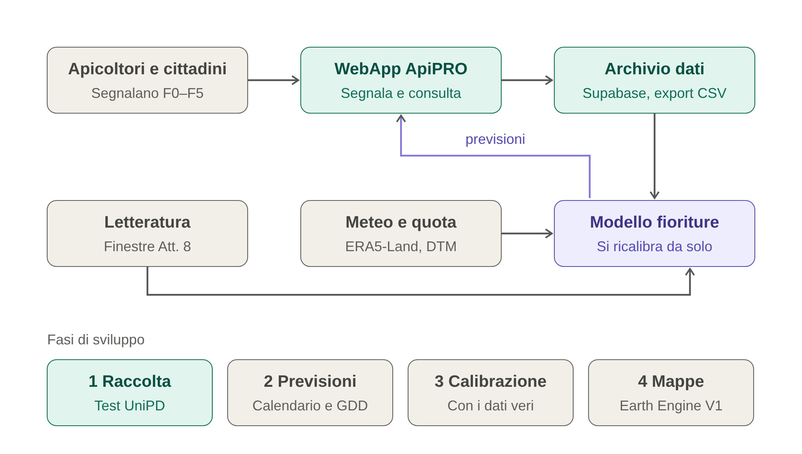
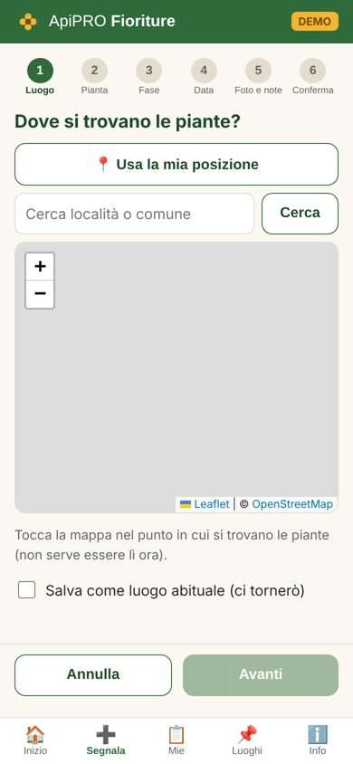
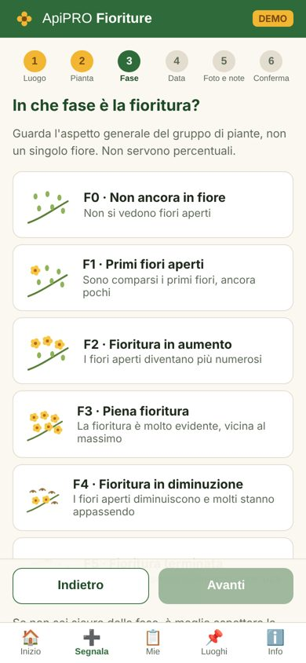
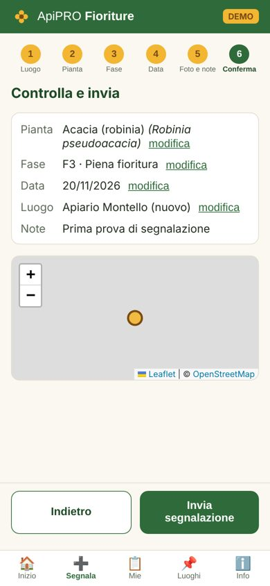
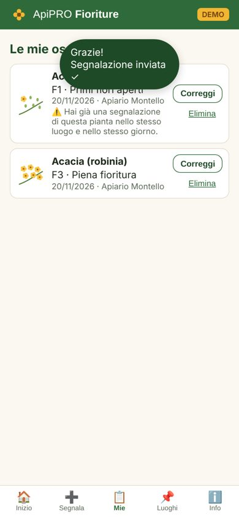

<p align="center"></p>

# ApiPRO Fioriture

**Segnala e prevedi le fioriture di interesse apistico in Veneto.**
WebApp di *citizen science* del progetto **ApiPRO** (PEI-AGRI, CSR Veneto 2023–2027): apicoltori e cittadini segnalano le fasi di fioritura delle principali piante mellifere; le segnalazioni alimentano un modello che prevede inizio, piena fioritura e fine nelle diverse zone della regione e si ricalibra con i dati raccolti.

[](https://github.com/JohnnyM1986/apipro-fioriture/actions/workflows/deploy-pages.yml)


👉 **Versione di prova:** https://johnnym1986.github.io/apipro-fioriture/
<sub>Collegata al database di TEST: i dati inseriti durante la prova possono essere azzerati.</sub>

---

## Indice

- [Come funziona](#come-funziona)
- [Partecipare](#partecipare)
- [Funzioni della release 0.1](#funzioni-della-release-01)
- [Le 11 piante e la scala F0–F5](#le-11-piante-e-la-scala-f0f5)
- [Architettura](#architettura)
- [Piano di sviluppo](#piano-di-sviluppo)
- [Dati e riservatezza](#dati-e-riservatezza)
- [Struttura del repository](#struttura-del-repository)
- [Sviluppo locale](#sviluppo-locale)
- [Crediti, fonti e licenza](#crediti-fonti-e-licenza)

## Come funziona



1. Le persone segnalano dal telefono **cosa vedono**: pianta, fase della fioritura (F0–F5), luogo e data.
2. Le segnalazioni finiscono in un archivio, esportabile in CSV dai responsabili del progetto per le elaborazioni scientifiche.
3. Il modello unisce le **finestre di fioritura di letteratura** con il **meteo e la quota reali** e stima quando ogni specie fiorirà in un punto del Veneto.
4. Ogni settimana confronta le previsioni con le segnalazioni e **si ricalibra**: all'inizio pesa la letteratura, con il tempo pesano sempre più i dati osservati in Veneto.

## Partecipare

Partecipare è semplice e non richiede registrazione:

- segnala **solo le piante che riconosci con sicurezza** e che vedi nei luoghi che frequenti;
- guarda l'**aspetto generale** del gruppo di piante (un campo, un prato, una siepe, un gruppo di alberi), non un singolo fiore;
- se torni spesso nello stesso luogo, aggiorna la fase **ogni 5–7 giorni**;
- indica la posizione **delle piante**, non quella in cui ti trovi mentre compili;
- se la fioritura finisce per **sfalcio, raccolta o rimozione**, scrivilo nelle note e non indicare F5 solo per questo;
- osserva solo da luoghi accessibili in sicurezza, senza entrare in proprietà private.

## Funzioni della release 0.1

<p align="center">
  
  
  
  
  
</p>

| Funzione | Dettaglio |
|---|---|
| Segnalazione in 6 passi | Luogo → Pianta → Fase → Data → Foto e note → Conferma. Obiettivo: 30–60 secondi con un luogo già salvato |
| Posizione | GPS (solo dopo autorizzazione), tocco sulla mappa o ricerca della località |
| Luoghi abituali | Apiari, boschi, appezzamenti o percorsi salvati e riusati senza reinserire le coordinate; possibili anche segnalazioni occasionali |
| Le mie osservazioni | Elenco delle proprie segnalazioni con correzione ed eliminazione |
| Controlli indispensabili | Luogo, pianta, fase e data valida (non futura): senza questi l'invio non è possibile |
| Avvisi facoltativi | Possibile duplicato (stessa pianta e data entro 50 m) e fase regressiva rispetto alla visita precedente; non bloccano l'invio |
| Foto | Facoltativa, ridotta prima dell'invio, conservata in archivio privato |
| Esportazione CSV | Archivio completo, una riga per osservazione, nessun dato personale (solo responsabili del progetto) |
| App installabile | PWA: si aggiunge alla schermata del telefono come un'app, senza store |

## Le 11 piante e la scala F0–F5

| Pianta | Nome scientifico | Dove si incontra |
|---|---|---|
| Acacia (robinia) | *Robinia pseudoacacia* | Boschi e gruppi di alberi |
| Castagno | *Castanea sativa* | Castagneti e gruppi di alberi |
| Tiglio | *Tilia* spp. | Filari e gruppi di alberi |
| Colza | *Brassica napus* | Campi coltivati |
| Girasole | *Helianthus annuus* | Campi coltivati |
| Tarassaco | *Taraxacum officinale* agg. | Prati e superfici erbose |
| Amorfa | *Amorpha fruticosa* | Siepi e popolamenti spontanei |
| Edera | *Hedera helix* | Su alberi, siepi e muri |
| Rododendro | *Rhododendron* spp. | Aree montane e popolamenti di quota |
| Limonio (fiorella di barena) | *Limonium narbonense* | Barena |
| Astro marino | *Tripolium pannonicum* | Barena |

| Fase | Come appare | Cosa significa |
|---|---|---|
| F0 | Non ancora in fiore | Non si vedono fiori aperti |
| F1 | Primi fiori aperti | Sono comparsi i primi fiori, ancora pochi |
| F2 | Fioritura in aumento | I fiori aperti diventano più numerosi |
| F3 | Piena fioritura | La fioritura è molto evidente, vicina al massimo |
| F4 | Fioritura in diminuzione | I fiori aperti diminuiscono e molti stanno appassendo |
| F5 | Fioritura terminata | La fioritura è sostanzialmente conclusa |

Non serve stimare percentuali e non c'è una sequenza obbligatoria: una prima segnalazione può essere direttamente F3 o F5.

## Architettura

| Componente | Soluzione |
|---|---|
| WebApp | PWA in React + TypeScript (Vite), mappa Leaflet con base satellitare Esri World Imagery (predefinita) e OpenStreetMap |
| Archivio | [Supabase](https://supabase.com) (PostgreSQL): accesso anonimo, permessi per partecipante (RLS), archivio foto privato, vista di esportazione |
| Meteo (fasi 2–3) | [Open-Meteo](https://open-meteo.com): ERA5-Land dal 1950 e previsioni a 16 giorni |
| Modelli fenologici (fasi 2–3) | [pyPhenology](https://github.com/sdtaylor/pyPhenology): modelli a gradi giorno con calibrazione |
| Automazioni | GitHub Actions: pubblicazione della WebApp; in seguito previsioni notturne e ricalibrazione settimanale |
| Analisi territoriali | Script Google Earth Engine *ApiPRO MAP 1.10* (NDVI, NDRE, CORINE, DTM, GDD) in `legacy/gee/` |

Dettagli in [`docs/ARCHITETTURA.md`](docs/ARCHITETTURA.md).

## Piano di sviluppo

- [x] **Fase 1 – Raccolta**: WebApp di segnalazione secondo protocollo, database, esportazione CSV *(release 0.1, in prova con l'Università di Padova)*
- [~] **Fase 2 – Previsioni** (in corso, versione sperimentale 0.3): modello a gradi giorno (soglie UNIPD per robinia, castagno e tiglio) con dati Open-Meteo ERA5-Land e previsioni a 16 giorni, calcolo notturno, schermata Previsioni – vedi [docs/PREVISIONI.md](docs/PREVISIONI.md)
- [ ] **Fase 3 – Calibrazione**: ricalibrazione automatica con le segnalazioni, registro delle versioni del modello ed errore medio in giorni
- [ ] **Fase 4 – Mappe**: livelli di potenzialità mellifera da Earth Engine e indice millefiori

## Dati e riservatezza

- I partecipanti **non forniscono nome né email**: un codice anonimo riconosce le segnalazioni dello stesso dispositivo.
- Ogni partecipante vede e corregge solo le proprie segnalazioni.
- Il CSV per le elaborazioni scientifiche contiene: identificativi anonimi, specie, fase, data dell'osservazione e d'inserimento, coordinate, presenza della foto, note e avvisi di qualità.
- Le segnalazioni **non sono in questo repository**: stanno nel database del progetto.
- L'informativa privacy completa sarà pubblicata prima del lancio.

## Struttura del repository

```
apipro-fioriture/
├── app/                  WebApp PWA (React + TypeScript)
│   └── src/              schermate, componenti, controlli, archivio dati
├── config/               catalogo specie (con fonti) e scala F0–F5
├── supabase/migrations/  schema del database, permessi, archivio foto
├── docs/                 architettura, riferimenti, immagini
├── legacy/gee/           script Earth Engine ApiPRO MAP 1.10
└── .github/workflows/    pubblicazione automatica della versione di prova
```

## Sviluppo locale

```bash
cd app
npm install
npm run dev     # senza variabili VITE_SUPABASE_* parte in MODALITÀ DEMO (dati solo nel browser)
npm test        # test dei controlli e dell'esportazione CSV
npm run build
```

Per collegarsi a un database copiare `app/.env.example` in `app/.env.local` e indicare URL e chiave pubblica del progetto Supabase. Lo schema si applica con i file di `supabase/migrations/` in ordine.

## Crediti, fonti e licenza

**Gruppo Operativo ApiPRO** – Apicoltura e Innovazione per la Produzione Regionale Ottimizzata (PEI-AGRI, CSR Veneto 2023–2027, Intervento SRG01). Capofila: Moretto Farm Società Agricola s.s.
Coordinamento tecnico e sviluppo: Dott. For. Johnny Moretto, Ph.D. (ATEA Group / Moretto Farm). Partner scientifico: Università di Padova.

Fonti e software di terzi:
- Taylor S.D. (2018). *pyPhenology: A python framework for plant phenology modelling*. JOSS 3(28):827. https://doi.org/10.21105/joss.00827
- Open-Meteo, dati ERA5 / ERA5-Land (CC BY 4.0).
- Mappe © [OpenStreetMap](https://www.openstreetmap.org/copyright) contributors; immagini satellitari © Esri, Maxar, Earthstar Geographics; libreria Leaflet.
- Finestre di fioritura: fonti indicate per specie in [`config/species.yaml`](config/species.yaml).

Codice distribuito con **licenza MIT** (vedi [`LICENSE`](LICENSE)).

<p align="center"></p>

<p align="center"><sub><i>Intervento cofinanziato dal Fondo europeo agricolo per lo sviluppo rurale (FEASR) – CSR Veneto 2023-2027, Intervento SRG01 – DGR 1132/2025 – Gruppo Operativo ApiPRO – Apicoltura e Innovazione per la Produzione Regionale Ottimizzata – Capofila: Moretto Farm Società Agricola s.s. – CUP B69H26001250009</i></sub></p>
