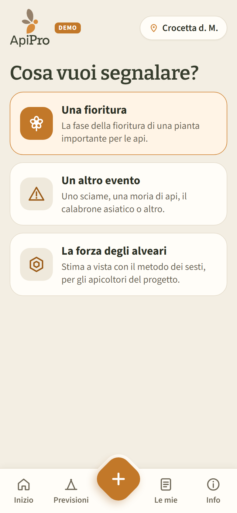
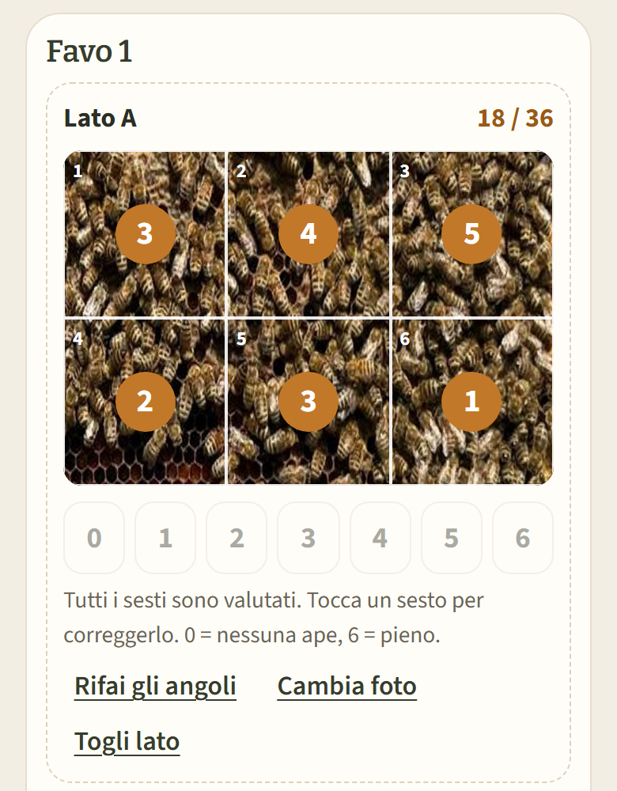

# Altre segnalazioni e forza degli alveari (release 0.4)

<p align="center">
  
  
</p>

Il pulsante «+» ora chiede **cosa vuoi segnalare**: una fioritura (come prima), un altro evento oppure la forza
degli alveari. Le fioriture restano la scelta principale e non cambiano.

## 1. Altre segnalazioni

- Tipi: **sciame**, **moria o spopolamento**, **calabrone asiatico** (*Vespa velutina*), **altro** (con nota obbligatoria).
  La lista è una proposta [DA VERIFICARE con i partner].
- Si indicano tipo, luogo (luogo salvato, mappa, GPS o ricerca), data e note. **Nessuna foto, nessun dato personale**:
  la segnalazione è anonima come le fioriture (tabella `events`).
- Compaiono in «Le mie» e si esportano in CSV dall'area responsabili.

## 2. Forza degli alveari (metodo dei sesti, valutazione a vista)

Attività 12 (WP4). Riprende lo strumento *stima-api-favo* senza l'analisi automatica: l'app **aiuta la stima a vista**.

1. L'apicoltore sceglie apiario e arnia, poi per ogni favo fotografa il **lato A**.
2. Tocca i **4 angoli** del favo (alto-sinistra, alto-destra, basso-destra, basso-sinistra): l'app raddrizza la foto e
   la divide in **6 sesti: 3 colonne × 2 righe** (due linee verticali e una orizzontale), numerati 1 2 3 in alto e 4 5 6 in basso.
3. Per ogni sesto indica con un tocco quanti sesti della sua superficie sono coperti di api, **da 0 (vuoto) a 6 (pieno)**.
   L'artefatto usava 1–6: lo 0 è stato aggiunto per i sesti senza api [DA VERIFICARE con il protocollo UNIPD].
4. Lo stesso per il **lato B**. Se la foto non viene bene si può valutare «senza foto», direttamente a vista.
5. Totali automatici: per lato (su 36), per arnia e media per lato.

**Report PDF (release 0.4.1).** Ogni stima salvata ha il pulsante **«Scarica PDF»** (dopo il salvataggio la stima si
apre da sola): logo ApiPRO, apicoltore, data, apiario e posizione, arnia e note, riepilogo (favi, lati, totale dei
sesti, media per lato) e, per ogni favo, le griglie 3 × 2 dei lati A e B con i valori colorati dal color carta (0)
all'ocra (6); in fondo loghi istituzionali, dicitura FEASR, versione dell'app e codice della stima. Il PDF si crea sul
telefono, senza server (libreria jsPDF caricata solo quando serve, disponibile anche senza rete); circa 90 KB, più
pagine se i favi sono tanti. Nome del file: `ApiPRO_forza_<data>_<arnia>.pdf`. Le foto non sono nel PDF.

**Le foto non vengono mai salvate né inviate**: restano nella memoria del telefono finché la pagina è aperta. Sul
database (tabella `strength_visits`) vanno solo data, apiario e posizione, arnia, i 6 valori di ogni lato e le note.
La stima in corso è salvata sul telefono (solo i numeri) e si riprende se la pagina si chiude per sbaglio.

### Accesso con codice personale

| Passo | Chi | Cosa succede |
|---|---|---|
| 1 | Apicoltore | In «Forza degli alveari» sceglie **Chiedi di partecipare**: nome e cognome, email, telefono (facoltativo), azienda, consenso privacy (dalla 0.4.2 non si chiede più il comune: la posizione degli apiari si registra a ogni stima) |
| 2 | App | Salva la richiesta (`strength_requests`) e manda una mail a **info@morettofarm.it** |
| 3 | Responsabile | In **Area responsabili → Richieste** sceglie **Approva e invia il codice** |
| 4 | App | Crea l'apicoltore (`beekeepers`) con il codice personale `APR-XXXX-XXXX`, attiva subito il telefono da cui è partita la richiesta e manda il codice per email all'apicoltore (mittente info@aquanatura.it, nome «ApiPRO – Progetto fioriture») |
| 5 | Apicoltore | Su ogni altro telefono o tablet sceglie **Ho un codice** e lo inserisce **una volta sola** |

- Il codice si verifica sul server e collega il dispositivo (utente anonimo di Supabase) all'apicoltore
  (`beekeeper_devices`): resta valido anche chiudendo l'app o riavviando il telefono. Va reinserito solo se si
  cancellano i dati del browser, si cambia telefono o, su iPhone, se l'app non è aggiunta alla schermata Home e non
  viene aperta per 7 giorni.
- Le stime sono sempre a nome dell'apicoltore: lo decide il database, non il telefono.
- **Area responsabili → Apicoltori**: codice da copiare, «Reinvia mail», «Nuovo codice» (il vecchio non vale più e i
  dispositivi vanno ricollegati), «Ritira codice» / «Riattiva», data della formazione, protocollo consegnato.
- Se la mail non parte (servizio non configurato o errore), l'app lo dice e mostra il codice da mandare a mano.
- Privacy: nomi e contatti degli apicoltori sono leggibili solo dai responsabili. Testo del consenso e informativa
  completa [DA VERIFICARE con chi segue la privacy del progetto]. Protocollo in PDF da collegare nell'app [DA VERIFICARE].

## 3. Area responsabili

Raggiungibile da Inizio (se si è responsabili) e da **Info → Area responsabili**. Si entra con il **codice
responsabili**, una volta per dispositivo. Contiene:

- **Richieste**: da approvare o rifiutare;
- **Apicoltori**: elenco con codici e azioni;
- **Esportazioni** CSV (separatore «;», apribili con Excel): fioriture, forza degli alveari (una riga per lato di
  favo: data, apicoltore, azienda, apiario, coordinate, arnia, favo, lato, sesti 1–6, totale, note), altre segnalazioni.

## 4. Configurazione (una volta sola, a mano)

### Chiave Brevo per le mail

1. Brevo → menu dell'account → **SMTP e API** → scheda **Chiavi API** → **Genera una nuova chiave API**, nome `apipro-mail` → copia la chiave.
2. Supabase → progetto `apipro-fioriture-test` → **Edge Functions** → **Secrets** → **Add new secret**:
   nome `BREVO_API_KEY`, valore = la chiave copiata → **Save**.
3. Facoltativi: `NOTIFY_EMAIL` (predefinito info@morettofarm.it), `SENDER_EMAIL` (predefinito info@aquanatura.it,
   deve essere un mittente abilitato su Brevo), `APP_URL`.

La chiave non va mai scritta nel codice, nei documenti o in chat.

Accorgimenti verificati il 21/11/2026 (configurazione completata, prima mail con il codice inviata):
- **Copiare la chiave con il pulsante «Copia» di Brevo**: copiandola a mano si rischia di prendere i puntini di
  mascheramento. La funzione toglie comunque spazi e caratteri invisibili.
- **Brevo → Impostazioni → Sicurezza → IP autorizzati → «Chiavi API»: blocco disattivato.** Le funzioni di Supabase
  escono da indirizzi IP che cambiano: con il blocco attivo Brevo rifiuta l'invio («unrecognised IP address»).
- **Scadenza**: Brevo disattiva le chiavi dopo **90 giorni senza invii** (e comunque alla scadenza scelta, 1 anno).
  Se le mail smettono di partire, generare una nuova chiave e sostituire il segreto `BREVO_API_KEY`.
- Diagnosi: Supabase → Edge Functions → apipro-mail → Logs (la risposta di Brevo è riportata per intero).

### Codice responsabili

Supabase → **SQL Editor** → eseguire (con un codice scelto da voi, almeno 10 caratteri):

```sql
select public.set_admin_code('il-vostro-codice');
```

Il codice è salvato cifrato (bcrypt) e non è leggibile dall'app. Per cambiarlo si riesegue lo stesso comando; chi è
già responsabile resta tale (tabella `admins`).

## 5. Parte tecnica

- Migrazione `supabase/migrations/0004_eventi_forza_codici.sql`: tabelle `events`, `strength_requests`, `beekeepers`,
  `beekeeper_devices`, `strength_visits`, `app_secrets`; funzioni `my_strength_status`, `redeem_beekeeper_code`,
  `approve_strength_request`, `renew_beekeeper_code`, `claim_admin`, `set_admin_code`; viste `export_strength`,
  `export_events`. Controlli: valori dei sesti 0–6, 6 valori per lato, nessuna data futura, una sola richiesta in
  attesa per dispositivo, «Altro» con nota.
- Funzione `supabase/functions/apipro-mail` (Edge Function, Deno): `nuova_richiesta` (solo richieste dell'ultima ora
  non ancora notificate) e `invia_codice` (solo responsabili).
- Verifiche fatte il 21/11/2026 sul database di prova: 14 controlli sulla logica e 9 sui permessi in transazioni
  annullate, 9 prove dal vivo con le chiamate dell'app (dati di prova poi cancellati), 20 prove nel browser su
  telefono e PC (`app/scripts/test-v04.mjs`).
- Avvisi del controllo sicurezza di Supabase attesi per questo disegno: funzioni `SECURITY DEFINER` richiamabili
  dagli utenti (è voluto: controllano da sole i permessi), accesso anonimo, tabella `app_secrets` senza regole di
  lettura (è voluto: illeggibile).
- In modalità DEMO tutto funziona sul solo dispositivo (richieste, approvazione, codici, stime) per le prove.
