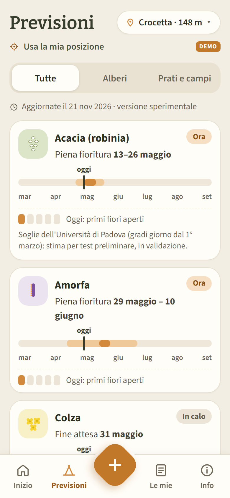
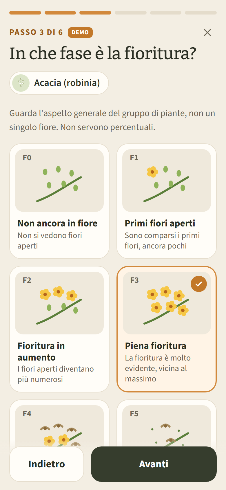

# Veste grafica della WebApp (release 0.3.1)

**Decisione:** proposta A «Prato» con il misuratore a tacchette della proposta B «Alveare»
(decisione di Johnny del 20/11/2026). Applicata a tutte le schermate dalla release 0.3.1.

  
  
  

*Schermate a 390 px con la data simulata 12/05/2027 e il punto Crocetta del Montello (modalità DEMO).*

La grafica cambia solo l'aspetto: funzionamento, modello di previsione, dati salvati e testi del protocollo
(etichette e definizioni delle fasi F0–F5, specie, avvertenze) restano quelli di prima.

## Colori

| Ruolo | Colore | Uso |
|---|---|---|
| Fondo carta | `#F3EEE3` | sfondo di tutte le pagine |
| Card | `#FFFDF8` | card, barra in basso, pulsanti bianchi |
| Bordo | `#E6DECE` | bordo sottile beige di card e campi |
| Tessera | `#EFE9DC` | fondo delle illustrazioni delle fasi e delle icone |
| Verde brand | `#363D2D` | card principale di Inizio, pulsante «Avanti», titoli |
| Ocra brand | `#D2893C` | tacche del misuratore, segmenti fatti, icona attiva, bordo della card scelta, decorazioni |
| Ocra pulsanti | `#C27829` | pulsanti ocra con testo bianco (più scuro per il contrasto) |
| Ocra testo | `#9A5A17` | testi ocra su fondo chiaro: «PASSO 4 DI 6», «Previsioni ›», voce attiva |
| Pillola «Ora / In piena» | fondo `#F6DFC2`, testo `#8A4F12` | specie in fioritura |
| Pillola «Tra X sett.» | fondo `#E3EAD3`, testo `#4E6131` | fioritura in arrivo |
| Pillola «In calo / Finita» | fondo `#ECE5D7`, testo `#675F50` | fioritura in diminuzione o finita |

Tutti i testi piccoli hanno contrasto almeno 4,5:1 sul loro fondo; il testo bianco sui pulsanti ocra è grande e in grassetto.

## Font

- **Bitter** (500 e 600) per i titoli, simile al lettering ApiPro.
- **Source Sans 3** (400, 600, 700) per il testo.

Sono installati come pacchetti (`@fontsource/bitter`, `@fontsource/source-sans-3`, solo i caratteri latini) e inclusi
nella cache dell'app installata: funzionano anche senza rete.

## Componenti

- **Testata** sul fondo carta (niente più barra verde): logo ApiPro a sinistra, badge DEMO/TEST piccolo, a destra
  l'etichetta arrotondata con il segnaposto e il punto delle previsioni (es. «Crocetta d. M.», tocca per aprire le Previsioni).
- **Barra in basso** bianca con icone a linea: Inizio, Previsioni, «+» ocra rialzato al centro (apre Segnala), Le mie, Info.
  La voce attiva è in ocra. Durante la segnalazione la barra lascia il posto ai pulsanti «Indietro» e «Avanti».
- **Inizio:** card verde scura con i petali del logo, «+ Segnala una fioritura»; «In fiore vicino a te» con 3 card
  (specie in fioritura ora, poi le più vicine, dal punto scelto) e il misuratore; «Il tuo contributo» con segnalazioni
  inviate e luoghi salvati; loghi istituzionali e dicitura FEASR in fondo.
- **Previsioni:** titolo, etichetta del punto con quota e menu a tendina, «Usa la mia posizione», filtro
  «Tutte / Alberi / Prati e campi», card per specie con date in grassetto, pillola di stato, barra della stagione
  marzo–settembre (fascia chiara = margine, nucleo ocra = piena fioritura, trattino «oggi») e misuratore.
- **Segnala:** barra di avanzamento a segmenti, «PASSO X DI 6», domanda in Bitter, etichetta della specie scelta,
  fasi in griglia a 2 colonne con illustrazione grande, card scelta con bordo e spunta ocra; pulsanti fissi in basso.
- **Misuratore** (dalla proposta B): 5 tacchette, quelle piene in ocra indicano l'intensità della fioritura attesa oggi.

| Fase attesa oggi | F0 | F1 | F2 | F3 | F4 | F5 |
|---|---|---|---|---|---|---|
| Tacche piene | 0 | 1 | 3 | 4 | 2 | 0 |

  La fase è quella del modello (stessa regola di `phase_today` in `model/apipro_model/thermal.py`), ricalcolata
  sulla data del telefono. Il modello non separa F1 e F2 («inizio/aumento»): solo per il misuratore la prima metà
  di quel periodo vale F1 e la seconda F2. Prima dell'inizio della fioritura (e prima dell'inizio della stagione)
  le tacche sono vuote con la scritta «Attesa tra …». Per i lettori di schermo il misuratore ha un testo
  alternativo, es. «Fase attesa oggi: piena fioritura».

## Gruppi di specie nel filtro delle Previsioni [DA VERIFICARE con UNIPD]

- **Alberi:** robinia (acacia), castagno, tiglio, amorfa, rododendro, edera.
- **Prati e campi:** tarassaco, colza, girasole, limonio, astro marino.

Il gruppo è un campo `group` del catalogo (`app/src/data/catalog.ts`) e serve solo al filtro.

## Verifiche

- Larghezza minima 360 px senza scorrimento orizzontale (controllata da `npm run screenshots` su Inizio,
  Previsioni, Le mie, Info, passo Fase e Conferma).
- Schermate rigenerabili: dalla cartella `app`, con le previsioni in `public/data/predictions.json`
  (`python model/run.py forecast`), `npx playwright install chromium` una volta e poi `npm run screenshots`.
